<!-- FUTURISTIC GITHUB PROFILE README -->

<div align="center">

# 👋 Hey, I'm Harsh Parmar

### `Data Science` × `Full-Stack Development` × `Generative AI`


[](https://github.com/harshparmar1)
[](https://www.linkedin.com/in/harsh-parmar-7532b3263/)


</div>

---

## 👨‍💻 About Me

```yaml
name: Harsh Parmar
education: MSc Data Science & Analytics
role:
  - Data Science Enthusiast
  - Full-Stack Developer
  - Generative AI Explorer
interests:
  - Artificial Intelligence
  - Machine Learning
  - Web Development
  - Innovation & Hackathons
mindset: Build | Learn | Innovate | Repeat
```

- 🔭 Building AI-powered applications and innovative real-world solutions.
- 🏆 Active hackathon participant with multiple competition wins.
- 🥇 Data-Wiz 2025 – 1st Place.
- 🥈 Bangalore Challenge – 2nd Place.
- 🚀 NASA Space Apps Challenge participant.
- 👯 Open to collaborating on AI/ML, Data Science and Open Source projects.
- 🌱 Exploring Generative AI, Deep Learning and advanced technologies.
- 💬 Ask me about Python, React, Next.js, FastAPI, MongoDB and Data Analytics.
- ⚡ I love transforming ambitious ideas into working products.

---

## 🏆 Hackathons & Achievements

<div align="center">

| Achievement | Recognition |
|:---|:---:|
| 🥇 Data-Wiz 2025 | 1st Place |
| 🥈 Bangalore Challenge | 2nd Place |
| 🚀 NASA Space Apps Challenge | Participant |
| 💡 Other Hackathons | Multiple Participation & Wins |

</div>

**My philosophy:** Every hackathon is an opportunity to learn, collaborate, experiment and build something impactful.

---

## 🚀 Featured Projects

### 🌍 AstroKites — Earth Observation & Climate Intelligence

An integrated platform that transforms satellite and meteorological data into actionable climate intelligence.

**Focus:** Geospatial Intelligence • Weather Alerts • Data Visualization • NASA POWER API

### 🌾 AgriBid — CropGuard AI

An AI-powered agriculture-focused solution designed to support smarter agricultural decisions.

**Focus:** Artificial Intelligence • Agriculture • Data Science

### 👥 Dayflow — HR Management System

A workforce management solution designed to streamline employee operations and HR workflows.

**Focus:** Full-Stack Development • HR Management • Database Systems

### ⚡ Adani Smart Meter Workforce App

A GPS-based workforce management and attendance application with employee tracking, site management and attendance reporting.

**Focus:** React Native • Expo • FastAPI • Firebase • Maps

### 🎓 AI-Powered Video Learning Platform

A learning platform that converts long YouTube tutorials into structured, day-wise and topic-wise learning experiences.

**Focus:** Generative AI • Python • MongoDB • Video Segmentation

---

## 🛠️ Tech Stack & Tools

<div align="center">

### Programming Languages


### Frontend Development


### Backend & Database


### Mobile & Data Technologies


</div>

---


## 📊 GitHub Analytics

<div align="center">

  
  

<br/>


</div>

---

## 🏆 GitHub Trophies

<div align="center">

 

</div>


---

## 📈 Contribution Activity

<div align="center">


</div>

---


## 🐍 Contribution Snake

<div align="center">


</div>

---

## 🤝 Let's Connect & Collaborate

<div align="center">

<a href="https://github.com/harshparmar1">

</a>

<a href="https://www.linkedin.com/in/harsh-parmar-7532b3263/">

</a>

</div>

---

<div align="center">

### ⚡ "Dream Big. Build Bold. Innovate Beyond Limits."


**Thanks for visiting my profile! Let's build something amazing together. 🚀**

</div>
